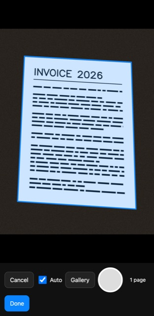
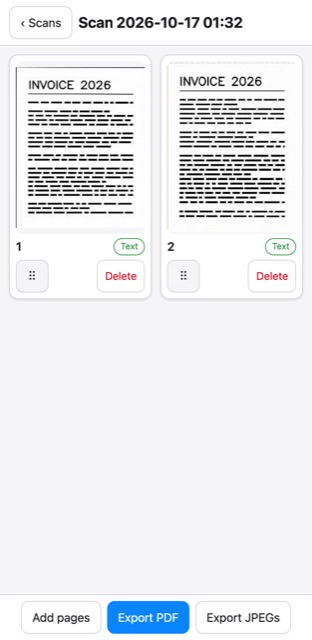
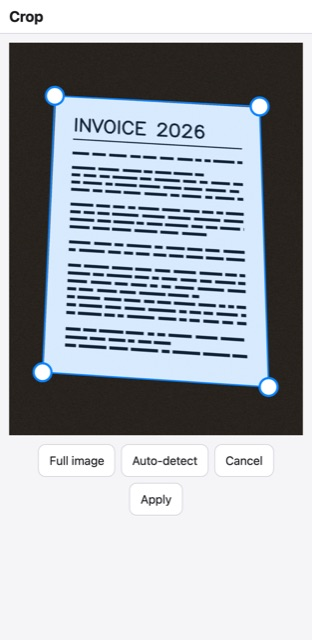

# Scanner

A private document scanner that runs in your browser. Point your phone at a page and the app finds
its edges, takes the shot when you hold steady, flattens and cleans up the image, reads the text,
and exports a searchable PDF.

Everything happens on your device. There are no accounts, no cloud and no trackers: documents are
stored in the browser, and a strict Content Security Policy blocks any connection to another site.
Once it has loaded, the app also works offline.

This is a clean-room rebuild of the core features of apps like CamScanner. No CamScanner code or
binary was used. See [docs/camscanner-research.md](docs/camscanner-research.md) for public-source
notes on CamScanner itself.

| Live detection | Document | Crop editor |
|---|---|---|
|  |  |  |

## Features

- **Live page detection** with an outline drawn over the camera feed, and **auto-capture** once
  the page holds still (one shot per page).
- **Perspective correction** with a crop editor: four draggable corners, a magnifier, and
  "Full image" / "Auto-detect" buttons.
- **Filters:** Original, Magic Color (removes shadows and uneven lighting), Grayscale, and B&W.
- **Text recognition (OCR)** in English, on the device.
- **Searchable PDF export** with an invisible text layer, so you can search and copy text. A4 or
  US Letter. You can also export pages as JPEGs.
- **Document library:** rename, reorder pages by dragging, re-crop or re-filter any page later
  (the original photo is kept), and delete.
- **Gallery import** for photos you already have, with phone rotation (EXIF) handled.
- **Offline-capable PWA** that can be installed to your home screen.

## Quick start

Requires Node.js 22.

```bash
npm install        # also copies the OCR engine and language data into public/vendor/
npm run dev        # http://localhost:5173
```

To try the production build:

```bash
npm run build
npm run preview    # http://localhost:4173
```

Your computer's webcam works on `localhost`. A phone camera needs HTTPS, so test on a phone by
deploying (see below) or through an HTTPS tunnel.

## Scripts

| Command | What it does |
|---|---|
| `npm run dev` | Development server with hot reload |
| `npm run build` | Typecheck, then build the static site into `dist/` |
| `npm run preview` | Serve `dist/` locally, with the same security headers as production |
| `npm test` | Unit and image-processing tests (Vitest) |
| `npm run test:e2e` | End-to-end tests in headless Chromium (Playwright), using a fake camera |
| `npm run fixtures` | Generate the synthetic test photos and fake camera video |
| `npm run vendor` | Re-copy the OCR engine files into `public/vendor/` |

The first time you run the end-to-end tests, install the browser with
`npx playwright install chromium`. Test photos are generated automatically when the tests need them.

## How it works

```
camera ─► 480 px frames ─► CV worker: detect page ─► outline + stability check ─► capture
                                                                                     │
photo ─► CV worker: flatten (perspective warp) + filter ─► IndexedDB ─► OCR queue (Tesseract.js)
                                                                                     │
                                                    pages + word boxes ─► PDF (pdf-lib) ─► share / download
```

- **Page detection** (`src/cv/detect.ts`) runs OpenCV.js in a Web Worker. It converts each frame
  to grayscale, blurs it, finds edges with Canny, and picks the largest convex four-sided outline
  that covers at least 20% of the frame. If that fails, it retries with more sensitive edge
  thresholds and then falls back to separating page from background by brightness. On synthetic
  test photos the detected corners land within 0.4% of the true positions.
- **Auto-capture** (`src/cv/geometry.ts`, `src/camera/autocapture.ts`) fires when the outline has
  moved less than 2% of the frame diagonal for 800 ms. It then waits until the page leaves or moves
  before taking another shot.
- **Filters** (`src/cv/process.ts`) estimate the lighting by blurring a heavily smoothed copy of
  the page and divide it out. That removes shadows before the contrast stretch or adaptive
  threshold.
- **OCR** (`src/ocr/`) runs Tesseract.js one page at a time in the background. Each page has a
  revision number, so a result for an older version of a page is never saved over a newer edit.
- **PDF export** (`src/pdf/pdf.ts`) places each recognised word, invisibly, over its position in
  the page image.
- **Storage** (`src/store/store.ts`) keeps documents and pages in IndexedDB.

### Privacy and the Content Security Policy

The policy is defined once in [`csp.ts`](csp.ts):

```
default-src 'self'; img-src 'self' blob: data:; media-src 'self' blob:; worker-src 'self' blob:;
script-src 'self' 'wasm-unsafe-eval'; connect-src 'self'
```

`connect-src 'self'` means the app can't send data anywhere except the site that serves it. All
libraries and the OCR language data are served from the same site.

OpenCV.js normally generates some of its code at startup with `new Function`, which this policy
forbids. Instead of allowing `'unsafe-eval'`, [`build/opencvNoEval.ts`](build/opencvNoEval.ts)
rewrites those spots into ordinary closures at build time. The build fails if the patch stops
matching after an OpenCV upgrade, or if any `new Function` or `eval` is left in the output.

## Deploying

`npm run build` produces a static site in `dist/`. Serve it over HTTPS from the site root.

The build also writes `dist/_headers`, which Netlify and Cloudflare Pages use to send the security
policy as a response header. The header matters: a `<meta>` tag only protects the page itself, not
the background workers or the service worker. For nginx and other hosts, see
[docs/deploy.md](docs/deploy.md).

## Project layout

```
src/
  camera/   camera access, auto-capture, capture queue
  cv/       OpenCV worker, page detection, warp and filters, quad geometry
  ocr/      Tesseract wrapper and background OCR queue
  pages/    saving and reprocessing pages, export preparation
  pdf/      searchable PDF builder
  store/    IndexedDB storage
  ui/       screens and components (Preact)
build/      Vite plugins: OpenCV no-eval patch, _headers generator
scripts/    copies the OCR engine files into public/vendor/
tests/
  unit/     Vitest unit tests
  cv/       image-processing tests against synthetic photos
  e2e/      Playwright tests: scan flow, import, offline, navigation
  fixtures/ test photo generator and ground-truth corners
docs/       design spec, implementation plan, deploy notes, CamScanner research
```

## Testing

- **156 unit and image-processing tests** cover the geometry, detection accuracy, filters, storage,
  OCR queue, PDF text placement, capture queue and navigation.
- **4 end-to-end tests** run the built app in Chromium with a fake camera: auto-capture → crop →
  B&W → searchable PDF; importing a rotated photo; first-time OCR fully offline; and leaving the
  camera with Cancel or Back. They also check that every request stays on the app's own site.

All tests use synthetic photos. Real-world accuracy on phone photos hasn't been measured yet.

## Limitations

- English OCR only.
- Not yet tested on real phones (iOS Safari and Android Chrome).
- Pages rotated around 45° in the frame aren't detected; use the crop editor.
- The offline cache is about 27 MB, mostly OpenCV and the OCR engine.

## Built with

[Preact](https://preactjs.com/), [Vite](https://vitejs.dev/),
[OpenCV.js](https://github.com/TechStark/opencv-js), [Tesseract.js](https://tesseract.projectnaptha.com/),
[pdf-lib](https://pdf-lib.js.org/), [idb](https://github.com/jakearchibald/idb),
[vite-plugin-pwa](https://vite-pwa-org.netlify.app/), [Vitest](https://vitest.dev/) and
[Playwright](https://playwright.dev/).
